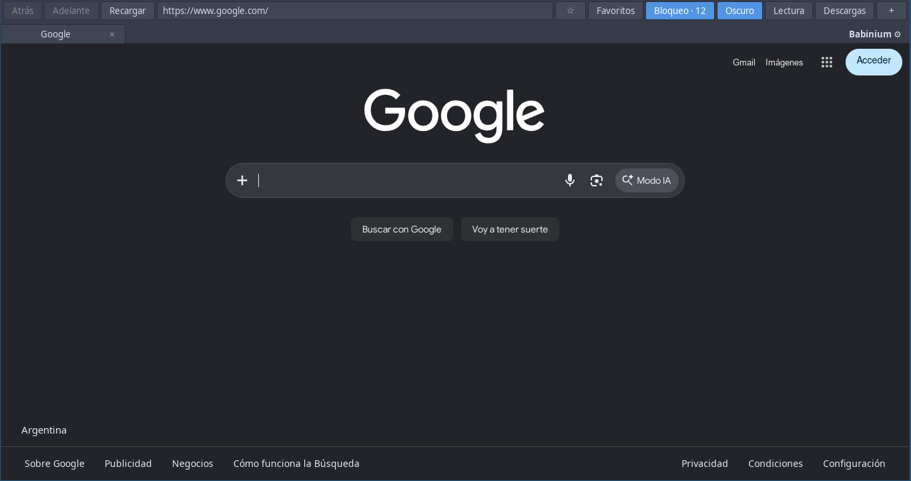
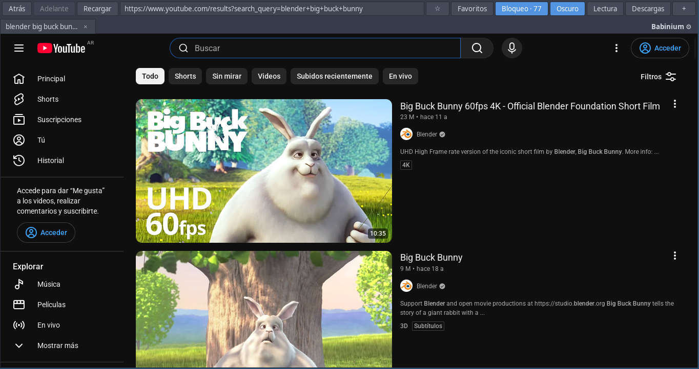
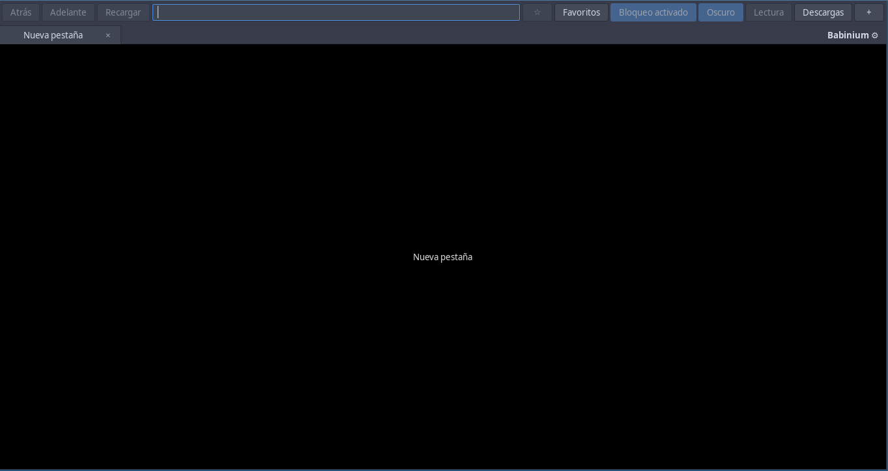

# Babinium Browser

<p align="center">
  
</p>

**Babinium es un navegador web liviano, pensado para computadoras viejas o de
pocos recursos.** Arranca rápido, gasta poca memoria y trae bloqueo de anuncios
de fábrica. Es un proyecto experimental, hecho a mano, gratuito y de licencia
libre (GPL-3.0 o posterior). Funciona en Debian 13 (amd64).

## Capturas


*Google en modo oscuro: el botón «Bloqueo · 12» muestra las solicitudes de
publicidad y rastreo que bloqueó la pestaña.*


*YouTube: la página queda liviana y el video se abre solo en MPV, fuera del
navegador, sin ahogar la computadora.*


*La interfaz completa: pestañas, favoritos, bloqueo, modo oscuro, modo lector,
descargas y la pestaña de ajustes («Babinium ⚙»).*

## ¿Qué lo hace distinto?

- **Liviano de verdad.** Una pestaña vacía ocupa unos 45 MB y la interfaz
  aparece en menos de un segundo, incluso en computadoras de hace más de una
  década.
- **Bloqueo de anuncios incluido, sin configurar nada.** La barra te muestra
  cuántas solicitudes de publicidad y rastreo bloqueó la pestaña.
- **YouTube sin ahogar la PC, y ahora sin abrir la página.** Los videos se
  reproducen en MPV, un reproductor liviano aparte: la página de YouTube queda
  liviana y tu máquina no carga con el video. Y con **Ctrl+clic sobre cualquier
  video de YouTube el video arranca en MPV al instante, sin abrir ni recargar
  la página**: buscá, hacé Ctrl+clic, mirá. Con preferencia por audio y
  subtítulos en español.
- **Modo lector con un clic.** El artículo queda solo, con letra cómoda y
  tamaño ajustable.
- **Modo oscuro en todas las páginas**, con excepciones por sitio si algo
  queda mal.
- **Motor actualizado por Debian.** El navegador usa el motor web del sistema,
  así que las correcciones de seguridad llegan con las actualizaciones normales
  del sistema.

> **Nota:** es un proyecto experimental en desarrollo. Funciona bien para el uso
> diario de su autor, pero no promete compatibilidad perfecta con toda la web.

## Descargar e instalar

Descargá el paquete para Debian 13 amd64 desde la [última versión publicada](https://github.com/babinium/babinium-browser/releases/latest).
El artefacto de GitHub Actions también contiene un `.deb` y `bundle/` ejecutable
sin instalar. Para el bundle se necesitan las dependencias de ejecución del paquete.

```sh
./bundle/bin/babinium-browser https://www.youtube.com/
# Instalación opcional:
sudo apt install ./babinium-browser_0.4.16_amd64.deb
```

«Abrir MPV» necesita una versión reciente de `yt-dlp`: la versión de abril de
2025 de Debian 13 falló con un video real de YouTube, mientras que la de
trixie-backports 2026.10.21 funcionó en esa prueba. El paquete exige MPV,
`gstreamer1.0-vaapi` y `yt-dlp` (≥ 2026.10.21) como dependencias obligatorias.

**¿Qué es trixie-backports y por qué hace falta?** Debian estable congela las
versiones de sus programas durante años; *backports* es un repositorio oficial
de Debian donde el equipo recompila versiones nuevas de algunos programas para
la versión estable. A la fecha de publicación, `yt-dlp` con soporte para el
YouTube actual solo está ahí. **Cómo activarlo:**

1. Agregá esta línea en `/etc/apt/sources.list` o en un archivo nuevo dentro de
   `/etc/apt/sources.list.d/`:
   `deb http://deb.debian.org/debian trixie-backports main`
2. `sudo apt update`
3. `sudo apt install yt-dlp/trixie-backports`
4. Volvé a instalar el paquete de Babinium.

Sin ese paso, la instalación del `.deb` falla con un aviso de dependencia
incumplida: es intencional, porque con un `yt-dlp` viejo YouTube queda roto.
Instrucciones completas en la [página de Debian
Backports](https://backports.debian.org/Instructions/).
YouTube cambia con el tiempo, por lo que ninguna versión garantiza reproducir
todos los videos; MPV no recibe automáticamente la sesión de Babinium. Algunos
videos pueden requerir además la [configuración de JavaScript de yt-dlp](https://github.com/yt-dlp/yt-dlp/wiki/EJS).
La selección se aplica al abrir o volver a abrir un video. Si la calidad elegida
no existe, se busca una inferior; si no hay un formato compatible a esa altura o
menor, MPV informará un error. El español se aplica solo a las pistas disponibles
en el video. La opción de subtítulos también se aplica al abrir o volver a abrir
un video; las pistas generadas automáticamente pueden contener errores. Para
videos que no son transmisiones en vivo se intenta limpiar repeticiones y
solapamientos de subtítulos automáticos SRT; si no se puede, se usa la pista
original. Se verificó con un video de YouTube; otros formatos pueden variar.

Perfil predeterminado: `~/.local/share/babinium-browser`. `--profile DIR` permite
perfiles de prueba independientes. No abrir simultáneamente dos instancias sobre
el mismo perfil. Descargas en la carpeta Descargas del usuario, sin sobrescribir.

Atajos: Ctrl+L dirección, Ctrl+T pestaña, Ctrl+W cerrar, Ctrl+Tab cambiar,
Ctrl+1…9 seleccionar, Ctrl+R recargar, Ctrl+Shift+R sin caché, Alt+flechas navegar,
Ctrl+B bloqueo por sitio, Ctrl+D guardar/quitar favorito, Ctrl+Shift+D favoritos,
Ctrl+Shift+M modo oscuro por sitio, Ctrl+J descargas. Con el mouse: clic con la
ruedita abre el enlace en una pestaña nueva al frente y Ctrl+clic sobre un video
de YouTube lo reproduce en MPV sin salir de la página. El panel de descargas permite forzar
la actualización de listas. Cambiar el bloqueo recarga la pestaña; otras pestañas
del mismo hostname aplican la decisión de red inmediatamente y necesitan recarga
para retirar los scriptlets ya ejecutados.
El contador muestra solicitudes bloqueadas acumuladas en la pestaña, incluyendo
seguimiento; no es un contador de anuncios de vídeo.

En un video o audio fuera de YouTube, { y } disminuyen o aumentan la velocidad
0,5× por pulsación, con un mínimo de 0,5× y un máximo de 16×. Aparece un indicador
temporal. Los atajos no se activan mientras se escribe; se permiten Mayúsculas o
AltGr para escribir las llaves según la distribución del teclado. Para medios en
un iframe de otro origen, hacé clic en el reproductor para enfocarlo. Algunos
reproductores, medios protegidos, elementos en componentes cerrados o
transmisiones pueden limitar estos controles.
En videos de YouTube incrustados en otros sitios, Babinium prioriza la velocidad
pedida; su indicador muestra la velocidad real, aunque el menú propio de YouTube
no coincida por encima de 2×. En la ventana de MPV se usan sus propios controles:
espacio o p pausa; las flechas izquierda y derecha retroceden o avanzan; [ y ]
cambian la velocidad en pasos finos, { y } la dividen o multiplican por dos;
Retroceso vuelve a 1×; 9 y 0 cambian el volumen; m silencia;
f y Esc controlan la pantalla completa; v muestra u oculta subtítulos y q cierra
MPV. Estos atajos pueden variar si se personalizó la configuración de MPV.
Después de cambiar la velocidad, el navegador escucha cambios del medio y
reaplica la elegida si el sitio la restablece, con reintentos limitados y sin
sondeo continuo. Tras cada cambio manual hace además una sola comprobación
breve para cubrir avisos de cambio perdidos. Si un reproductor la fuerza
repetidamente, puede prevalecer su límite.

En páginas de YouTube se deshabilita la reproducción multimedia de WebKit y se
bloquean las solicitudes de video conocidas hacia Googlevideo y los manifiestos
de YouTube. Esto no bloquea el tráfico independiente de MPV ni los videos de
otros sitios. YouTube puede cambiar su implementación: la carga de sus
recomendaciones y la ausencia de solicitudes de video necesitan prueba manual.
La persistencia del perfil no garantiza que Google acepte iniciar sesión en
todos los navegadores integrados.

## Funciones en detalle

- Barra de direcciones con búsqueda Google, atrás/adelante, pestañas y descargas.
- Pestañas vacías negras y «Babinium ⚙» en el extremo derecho de la barra.
- Favoritos en el perfil, con estrella y panel amplio de títulos y nombres de
  sitio; cookies y datos de sitios persistentes entre reinicios.
- Control integrado de velocidad para medios HTML5 mediante { y }, con un
  indicador temporal. Al pulsar
  «Babinium» se abre una pestaña de ayuda GTK.
- Al abrir un video de YouTube, Babinium mantiene la página abierta, deshabilita
  su reproducción y abre el video automáticamente en MPV. Otro video reemplaza
  al anterior en el mismo MPV. «Abrir MPV» permite volver a abrir el video tras
  cerrar el reproductor; MPV puede seguir funcionando al cerrar el navegador.
  La resolución se elige entre 144p y 1080p en la pestaña «Babinium»; el valor
  inicial es 720p y la elección se guarda. Prefiere H.264 y audio en español
  cuando están disponibles. Los subtítulos son opcionales, están desactivados por
  defecto y la elección se guarda: se prefiere el español y, si falta, otro
  idioma disponible. Requiere MPV y yt-dlp.
- La decodificación de video en MPV usa la GPU con VA-API cuando está
  disponible (Sandy Bridge o más nuevo en Intel); si un stream no la soporta,
  MPV vuelve a decodificar por software. Con el paquete recomendado
  `gstreamer1.0-vaapi`, los videos incrustados en páginas también usan la GPU.
- Los enlaces de la barra de direcciones y de las páginas tienen atajos de
  mouse: **clic con la ruedita** abre el enlace en una pestaña nueva al frente
  (YouTube, streams .m3u8/.mpd/.m3u o cualquier sitio), y **Ctrl+clic sobre un
  video de YouTube lo reproduce en MPV sin salir de la página actual** (también
  con shorts, directo y youtu.be); Ctrl+clic en otros enlaces navega normal.
- Los enlaces a streams `.m3u8`, `.mpd` y `.m3u` (televisión en vivo y listas
  IPTV) también se abren en la ventana de MPV, al pulsarlos o escribirlos en la
  barra de direcciones. No cubre streams con DRM cifrado, que requieren el
  módulo de descifrado integrado de Chromium o Firefox.
- La pestaña de ayuda («Babinium ⚙») incluye ajustes para equipos moderados:
  reglas por dominio para cargar sin imágenes o sin JavaScript (con recarga de
  la pestaña al aplicar), límite de caché en disco con recorte de los archivos
  más viejos al iniciar, y la opción de forzar el compositing acelerado.
  El motor en uso se muestra en esa misma sección.
- El botón «Lectura» de la barra activa el modo lector: muestra solo el título
  y el artículo de la página actual, con letra serif cómoda, paleta clara u
  oscura según el sistema y detección del contenido que incluye los selectores
  habituales de los CMS de noticias y el título de las meta-tags. El tamaño de
  letra se ajusta con los botones A- y A+ del recuadro flotante o con las
  teclas - y +; para volver a la página original, el mismo botón o la × del
  recuadro.
- Para reducir CPU, las animaciones CSS infinitas muy alejadas de la pantalla
  se pausan y vuelven a moverse antes de entrar en la vista. La opción se puede
  desactivar desde la ayuda al pulsar «Babinium»; recargá luego la página.
- Modo oscuro predeterminado con la API local de Dark Reader; el botón Oscuro
  permite excluir un sitio. YouTube usa su propio tema oscuro cuando está
  disponible. Cuando el fondo y varios puntos visibles ya son oscuros se evita
  transformar la página; es una heurística inicial, no detección perfecta. La
  integración API no incluye todas las correcciones de la extensión de
  escritorio y respeta las restricciones CORS de la página.
- Bloqueo de solicitudes, CSS específico y genérico, scriptlets uBO/Brave.
- Bloqueo activado por defecto y excepciones por hostname exacto con Ctrl+B.
- EasyList, EasyPrivacy y filtros de uAssets incluidos; actualizaciones HTTPS
  en segundo plano, con validación y cambio atómico. Un fallo conserva la versión
  anterior. Sin servicio residente para actualizar ni intérprete para navegar.
- Sandbox multiproceso de WebKit habilitado, TLS del sistema y cookies sin
  terceros. El motor se actualiza con las actualizaciones de seguridad de Debian.

## Arquitectura y límites

La extensión de WebKit ejecuta el matcher Rust en su hilo principal, sin IPC por
solicitud. Un motor por proceso web, compartido por las páginas de ese proceso.
Las pestañas vacías son widgets GTK: el contexto WebKit y las vistas se crean
sólo al navegar. Abrir pestañas vacías no inicia procesos web ni carga el índice.
Se carga un índice serializado; no se parsean listas al arrancar la interfaz.
Los scriptlets se inyectan al crear el contexto JavaScript antes de los scripts
del sitio; la consulta cosmética nativa está en un mundo aislado. Los cambios del
DOM se agrupan, sin sondeo permanente. El filtrado cosmético conserva un máximo
de ocho conjuntos pequeños de excepciones por URL para evitar volver a calcular
los recursos completos al aparecer clases nuevas; se limpia al cambiar el motor.
La política de caché reduce retención a
cambio de volver a cargar páginas al retroceder; no se desactivan JIT ni sandbox.
La optimización de animaciones usa `IntersectionObserver`, sin sondeo continuo,
y deja intactas las animaciones finitas y los elementos que las combinan con
otras infinitas. Tiene un límite de 256 elementos observados por documento.
Pausar animaciones lejanas puede afectar páginas que dependan de sus eventos;
si ocurre, desactivá la opción en la ayuda y recargá. El cambio afecta a páginas
posteriores o recargadas y no modifica la preferencia de JavaScript.

`WebPage::send-request` permite cancelar y cambiar URLs, pero la API pública no
expone el tipo exacto de recurso ni su frame iniciador. Se usa Sec-Fetch-Dest si
está disponible, Referer, Accept y finalmente sufijos de URL. Las solicitudes
desconocidas se clasifican como `other`. Esto limita reglas con tipos específicos,
algunos iframes, workers y WebSockets. No hay filtrado HTML ni reescritura nativa
del cuerpo de respuestas. Los scriptlets compensan parte de esta carencia;
**no equivalen a integrar todo Brave ni todo uBlock Origin**.

La ejecución cosmética tiene límites de trabajo para no monopolizar CPU; una
cola muy grande puede omitir elementos y algunos operadores complejos. El
bloqueo de vídeo de YouTube cambia por región, sesión y experimento. Los filtros
actuales y los recursos uBO/Brave son necesarios, pero no garantizan eliminar
anuncios integrados en el mismo flujo del contenido. Véase `docs/feasibility.md`
y la evidencia de pruebas para el alcance comprobado.

## Construir en Debian 13

```sh
sudo apt install build-essential pkg-config libwebkit2gtk-4.1-dev \
  libgtk-3-dev libjson-glib-dev libsoup-3.0-dev python3 nodejs ca-certificates
# Con trixie-backports configurado (Rust >= 1.88):
sudo apt install -t trixie-backports cargo rustc
make -j2
make resources
make test
make package
```

El workflow manual `Compilar Debian 13 amd64` realiza estos pasos en un contenedor
Debian 13. Opciones genéricas x86-64, sin `-march=native` ni adaptación al equipo.
Actions compila, empaqueta y ejecuta pruebas unitarias. Las pruebas gráficas con
sandbox y YouTube real se ejecutan como usuario normal en Debian; Docker introduce
restricciones distintas sobre los namespaces de bubblewrap.
Las listas se descargan al construir; los recursos de código tienen revisiones
fijas en `data/upstream.json`. Cada descarga incluye procedencia y hash; las
fuentes originales de los recursos se entregan con el artefacto. `Cargo.lock`
fija las dependencias después de la primera compilación.

## Diagnóstico y medición

No se recopila telemetría en uso normal. `--telemetry FILE` escribe localmente
eventos JSONL con URLs y tiempos. `--audit` añade URLs bloqueadas. `--eval FILE`,
`--probe-interval N`, `--screenshot PNG` y `--quit-after N` son opciones explícitas
para reproducir pruebas. `--no-block` sirve para comparaciones; `--no-update`
separa las mediciones estables del trabajo de actualización.

La medición debe sumar todos los procesos: RSS suma memoria compartida varias
veces, PSS la reparte. Deben publicarse ambas, cantidad de procesos, CPU acumulada
y por intervalo, tiempo hasta mostrar interfaz y hasta contenido útil. Comparar
con otros navegadores exige misma URL, resolución de vídeo, perfil, caché,
sesión, aceleración y duración. El tamaño del binario no mide el consumo.

## Historial de validación

**Estado: experimental.** No se presenta como el navegador de menor consumo.
En versiones anteriores se validaron reproducción real de YouTube, bloqueo de
solicitudes publicitarias y modificación de datos del reproductor. La eliminación
de preroll/midroll no quedó demostrada porque el control tampoco mostró anuncios
de vídeo. Miguel informó que la apertura automática de MPV de la versión 0.4.7
funciona; en 0.4.12 se verificaron nuevamente MPV, resolución, subtítulos y los
nuevos controles de velocidad.
Véanse los informes de [validación 0.4.12](docs/validation-0.4.12.md), [validación 0.4.5](docs/validation-0.4.5.md), [validación 0.4.4](docs/validation-0.4.4.md), [validación 0.4.3](docs/validation-0.4.3.md),
[validación 0.4.2](docs/validation-0.4.2.md), [validación 0.3.1](docs/validation-0.3.1.md),
[validación 0.3.0](docs/validation-0.3.md), [validación 0.2](docs/validation-0.2.md) y del
[prototipo inicial 0.1](docs/validation.md).
La [lista de requisitos y su estado](docs/REQUISITOS.md) conserva todos los
pedidos y los puntos que todavía requieren pruebas.
